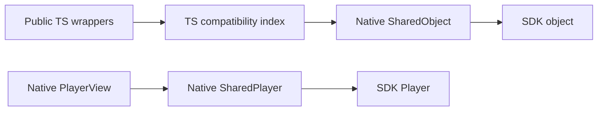

# SharedObject binding architecture

Player, Source, and OfflineContentManager retain `nativeId` compatibility because
the identity test suites exercise those APIs. Configuration wrappers and internal
UI adapters have no binding IDs. Native methods and view props receive Expo
SharedObjects.

## Compatibility boundary

`src/nativeInstanceRegistry.ts` is the only binding identity index. Its entries
contain either an initialized SharedObject or its pending creation promise.
Player, Source, and OfflineContentManager aliases resolve to the same native backend while keeping their own
public configuration and lifecycle flags. Removing a pending entry disposes its
result when creation finishes, without replacing a newer object using that ID.

Compatibility labels are removed from configuration before native calls. User
metadata and HTTP headers remain ordinary data, including keys named `nativeId`.
SDK content, track, quality, and license identifiers retain their SDK meaning.

## Ownership and creation

Player and Source factories create configured SDK objects once. Creation runs on
the native main thread. Lightweight empty objects preserve existing defaults for
calls made before initialization or after destruction.

Configuration, DRM, offline, fullscreen, and custom-message adapters also use
SharedObjects. They are passed directly to their consumers. Offline event labels
are added in TS to preserve the public event shape. Configuration and UI wrappers
keep their native owners by object reference. Buffer, analytics, and media-control
helpers take a Player reference instead of storing an ID string. FairPlay runtime
helpers take a Source reference; the SDK content `skdUri` remains unchanged. A named backend retains its
configuration dependencies so they remain alive after its original TS wrapper is
dropped; destruction through any alias closes those dependencies.

Views retain their player. The player has no view reference, attachment lookup,
or pending PiP settings. View attachment, SDK event listeners, PiP settings, and
view cleanup belong to the view. Expo view ref methods update PiP settings while
Android is in PiP, and readiness reapplies initial settings.

Native owners use their nullable SDK reference as the resource lifetime indicator.
There is no separate closed flag. Clearing the reference preserves the public
post-destroy defaults without calling a destroyed SDK instance.

Explicit player destruction runs directly in Expo's main-queue AsyncFunction and
resolves after SDK cleanup. Automatic GC/finalization has no async executor guarantee;
resources whose SDK requires the main thread retain one final main-thread handoff.
JS compatibility entries retain initialized resources until explicit destruction,
as required by legacy ID lookup. This does not promise one JS wrapper per native
instance: aliases are part of the public API.

## Direct callbacks

A configuration owner receives one JS callback dispatcher. Native code schedules
it through Expo. Synchronous SDK callbacks consume the JS function's return value
on the JS thread, signal a local native waiter, and preserve the existing timeout
and fallback. They create no completion SharedObject or Expo registry association.
Unexpected Promise returns use the synchronous fallback and consume rejection.

Asynchronous network preprocessing receives a per-call completion SharedObject.
JS resolves that object directly; no application request ID or completion lookup
map is needed. The native completion function is cleared after settlement so it
cannot complete twice or retain its captured work until GC.

The callback function reference also indicates callback availability. Destruction
clears it and wakes synchronous waiters. Late synchronous results and duplicate
async completions are ignored. Native collection and runtime reload still need
focused checks; bridge mocks cannot establish cross-heap collection.

## Validation boundaries

The unchanged Cavy suites exercise playback, advertising decisions, network
preprocessing, aliases, metadata, destruction, ID reuse, and view remounting. Node
fixtures check the TS compatibility layer, callback fallbacks, creation races,
and native argument shapes. Their mocked native objects do not prove SDK cleanup.

Offline downloads, simultaneous views, active PiP transitions, runtime reload,
and collection of callbacks capturing their own player need focused native or
app checks in addition to the existing suites. Report those checks separately
from the unchanged suite results.
