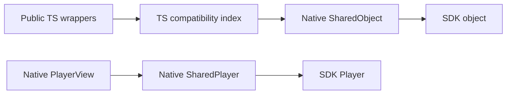

# SharedObject binding architecture

Public constructors, `nativeId`, lifecycle methods, events, and method return
shapes stay compatible. Native methods and view props receive Expo SharedObjects.

## Compatibility boundary

`src/nativeInstanceRegistry.ts` is the only binding identity index. Its entries
contain either an initialized SharedObject or its pending creation promise.
Same-kind aliases resolve to the same native backend while keeping their own
public configuration and lifecycle flags. Removing a pending entry disposes its
result when creation finishes, without replacing a newer object using that ID.

Compatibility labels are removed from configuration before native calls. User
metadata and HTTP headers remain ordinary data, including keys named `nativeId`.
SDK content, track, quality, and license identifiers retain their SDK meaning.

## Ownership and creation

Player and Source factories create configured SDK objects once. Creation runs on
the native main thread. Lightweight empty objects preserve existing defaults for
calls made before initialization or after destruction.

Configuration, DRM, offline, fullscreen, and custom-message adapters also use
SharedObjects. They are passed directly to their consumers. Offline event labels
are added in TS to preserve the public event shape.

Views retain their player. The player has no view reference, attachment lookup,
or pending PiP settings. View attachment, SDK event listeners, PiP settings, and
view cleanup belong to the view. Expo view ref methods update PiP settings while
Android is in PiP, and readiness reapplies initial settings.

Explicit destruction closes callbacks and releases SDK resources. Expo release
hooks provide cleanup when associations are released. JS compatibility entries
retain initialized resources until explicit destruction, as required by legacy
ID lookup. This does not promise one JS wrapper per native instance: aliases are
part of the public API.

## Direct callbacks

A configuration owner receives one JS callback dispatcher. Native code schedules
it through Expo with the operation's arguments and a per-call completion
SharedObject. JS resolves that object directly; no request ID or completion lookup
map is needed. Promise-returning preprocessing callbacks use the same contract.

Synchronous SDK callbacks wait for their local result with the existing timeout
and fallback. Completion runs on the JS thread, so it can unblock an SDK callback
waiting on the native main thread. Destruction wakes synchronous waiters and
clears retained callback functions. Late and duplicate results are ignored.

Retained callbacks can capture application objects. Explicit destruction and
runtime teardown must release them. Native collection and reload behavior need
runtime checks; bridge mocks cannot establish cross-heap collection.

## Validation boundaries

The unchanged Cavy suites exercise playback, advertising decisions, network
preprocessing, aliases, metadata, destruction, ID reuse, and view remounting. Node
fixtures check the TS compatibility layer, callback fallbacks, creation races,
and native argument shapes. Their mocked native objects do not prove SDK cleanup.

Offline downloads, simultaneous views, active PiP transitions, runtime reload,
and collection of callbacks capturing their own player need focused native or
app checks in addition to the existing suites. Report those checks separately
from the unchanged suite results.
