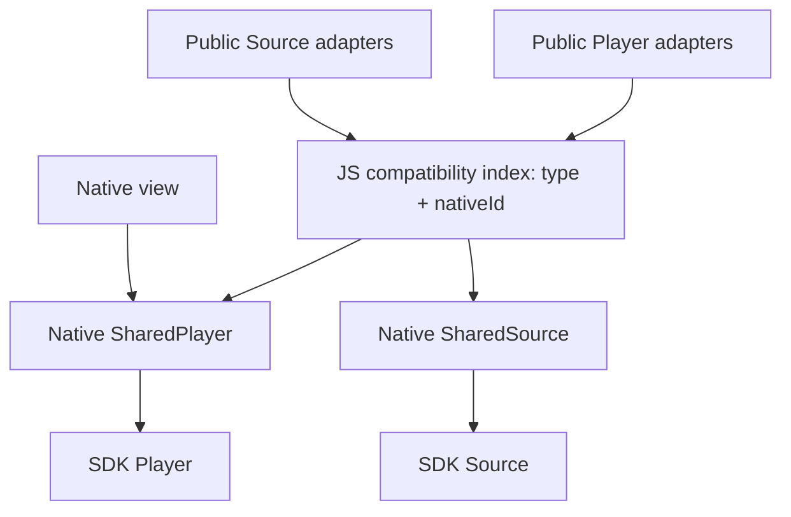

# SharedObject lifecycle POC

This POC migrates native Player and Source ownership to Expo SharedObjects while
preserving the existing public constructors, `nativeId`, lifecycle methods,
callback configuration, return shapes and PlayerView event props. It targets the
installed Expo Modules Core 57.0.23.

## Ownership and compatibility



`src/nativeInstanceRegistry.ts` is the only player/source identity index. It
stores strong references to native SharedObjects in separate type namespaces,
starting at explicit initialization. Named and generated IDs remain usable by
legacy helper constructors. Public wrappers keep their own configuration,
source field and lifecycle flags, matching the existing API. Construction alone
creates no native object and adds no strong registry entry.

The wrapper that initializes supplies its own configuration to the shared native
backend. Constructing an earlier unused same-ID wrapper must not capture or
replace that configuration. Failed initialization can retain a retryable native
transport until explicit destruction; synchronous transport factory failures do
not add an entry.

Strong references intentionally preserve native ID-based rediscovery until
explicit `destroy()`. Automatic collection cannot also preserve an
otherwise-unreferenced object indefinitely for later lookup by a string. The
existing hook ownership contract stays unchanged: `usePlayer` retains its initial
player and applications continue to destroy it explicitly. The hook now
constructs once, avoiding unused wrappers on subsequent renders.

Private implementation code resolves each wrapper's current shared backend at the JS
compatibility boundary. Ordinary methods then call the native object directly;
no native string lookup participates in playback, source operations or view
attachment. Legacy helpers such as `BufferApi(id)` use the same index, preserving
construction before initialization and replacement under the same ID. Queries
before initialization or after destruction use an uncached transport without an
SDK resource, preserving default/no-op results.

Callback completions capture the native object that emitted the request. They
must not resolve the ID again after a replacement is created, because completion
IDs are scoped to each native object.

## Public API

Existing application code continues to work:

```ts
const player = new Player({ nativeId: 'main-player' });
const alias = new Player({ nativeId: 'main-player' });
const source = new Source(sourceConfig);

await player.initialize();
alias.loadSource(source);
alias.play();
player.destroy();
```

The two Player wrappers above remain distinct JS objects, as before, and their
methods address the same initialized backend. The existing PlayerView `player`,
event and readiness props are unchanged. Native
view props receive Expo's numeric object handle through a private TS adapter;
Expo converts it to a typed SharedPlayer. The old player ID remains only as the
public readiness event's compatibility label.

Public methods retain their previous void/Promise shapes and bound function
behavior. TS bodies are small forwarding methods. Initialization, JS callback
invocation, platform warnings and destruction of unmigrated configuration
adapters still contain the logic needed to preserve their existing contracts.
No raw SharedObject accessor is added to the public API. Player uses a private
getter; Source uses a module-private resolver so it remains structurally
assignable in TypeScript, as before.

## Deleted bookkeeping

- Both native PlayerRegistry implementations and their destruction sweeps.
- Native source instance maps, source lookup methods and iOS cast/subscription
  maps. Source-specific state now lives on its SharedSource.
- Player/source ID parameters on native instance methods.
- The buffer, analytics and media controls forwarding modules on both sides of
  the bridge. Their public helper classes call SharedPlayer methods directly.
- Player-ID-to-view maps and pending PiP dictionaries. Each SharedPlayer has a
  weak attached view and consumes pending PiP settings on attachment.
- The standalone FairPlay registry class. SharedSource directly stores native
  key requests by skdUri in a locked dictionary. Renewal requires the original
  native request, and the SDK provides no lookup from the public skdUri value.
- Module-level advertising event multiplexing and JS nativeId filters. Callback
  events, completion IDs and waiters are scoped to their SharedPlayer, so event
  payloads no longer carry player IDs.
- Unused source IDs on native SharedSource owners and their factories. The
  public Source.nativeId remains in the JS compatibility index.

Callback completion IDs still identify outstanding operations, rather than
player instances. Their bounded waits remain necessary for synchronous SDK
callbacks. Destruction wakes pending waiters before clearing them.

## Native lifecycle

Factories create lightweight SharedObjects synchronously. Existing async
initialization creates SDK resources on the main thread after JS callback
listeners are installed. This preserves IMA creation-time callback ordering.

Android uses Expo's official module Gradle plugin. Its Pika compiler support is
required for exported SharedObject return types; the old Gradle setup compiled
but left unresolved reified-type code that failed at module startup.

Explicit `destroy()` closes the SDK resource idempotently and removes its JS
index entry. It does not immediately call Expo `release()`, so an application
retaining the destroyed public adapter can still use its existing no-op/default
query behavior. Expo eventually releases the association after the adapter is
collected or the runtime is torn down.

Player release hooks mark the owner closed immediately and perform SDK teardown
on the main thread. Cleanup is independent of queues canceled during runtime
shutdown. It releases the media-session connection and destroys the SDK player
while the view's listeners can still deliver the final public onDestroy event,
then detaches the view. Late initialization cannot reopen a closed owner. iOS
also has a deallocation fallback for runtime shutdown paths that skip release
hooks.

A view detaches independently of the player, so remounting the UI can reuse the
same native player. Both platforms attach after Expo has applied the view's prop
batch. On iOS, replacement reuses the existing fullscreen/PiP teardown before
detaching the old player. Android's platform PiP tracking remains necessary. Live PiP
updates continue through object-targeted commands because Android may suppress
view prop delivery while PiP is active.

## Scope remaining after the POC

Offline managers, network/DRM/decoder configuration adapters, fullscreen and
custom-message handlers still use their existing native registries and callback
transport. They remain functional and can be migrated in later slices. The
shared Registry/NativeId type aliases and NativeInstance base therefore remain.

The POC retains TS initialization flags and sequencing. Removing these without
changing the public API requires native equivalents and a separate migration of
the configuration callbacks. SharedObjects alone do not eliminate that work.

Further Expo facilities worth evaluating are typed Records, direct native view
ref methods and Swift export macros. Keep TS declarations
handwritten: the SDK 57 type generator does not preserve SharedObject inheritance
or class event typing sufficiently for this binding.

## Verification

The JS compatibility suites run through the TypeScript CI workflow:

```sh
node --test scripts/test-native-instance-registry.js scripts/test-shared-object-compatibility.js
```

They cover ID namespaces, constructor aliases, destruction/replacement, legacy
helpers, return shapes, object-scoped callbacks and hook rerenders. Their native
boundary is mocked; they do not establish native cleanup or playback.

The Cavy selector `shared-object-lifecycle` is registered on Android and iOS:

```sh
yarn integration-test test:android --tags shared-object-lifecycle
yarn integration-test test:ios --tags shared-object-lifecycle
```

It checks real source metadata conversion, type isolation, aliased playback,
seek/query behavior, same-ID recreation and native view remounting. Follow the
integration app setup and observe events before triggering actions. The existing
integration-test workflow is a stub and provides no automated Cavy execution.
Report local native execution separately from JS test results.

Successful encrypted playback, casting, background playback, PiP, offline
downloads, fullscreen/PiP replacement transitions, GC/runtime teardown and
explicit Expo release still need their own native scenarios. The existing DRM
error-path test does not establish encrypted playback. tvOS validation also
remains separate.

## Expo references

- [SharedObject guide](https://docs.expo.dev/modules/shared-objects/)
- [Module and view APIs](https://docs.expo.dev/modules/module-api/)
- [SDK 57 view handle adapter](https://github.com/expo/expo/blob/sdk-57/packages/expo-video/src/VideoView.tsx)
- [SDK 57 class generation limitations](https://github.com/expo/expo/blob/sdk-57/packages/expo-type-information/src/typescriptGeneration.ts#L646-L680)
